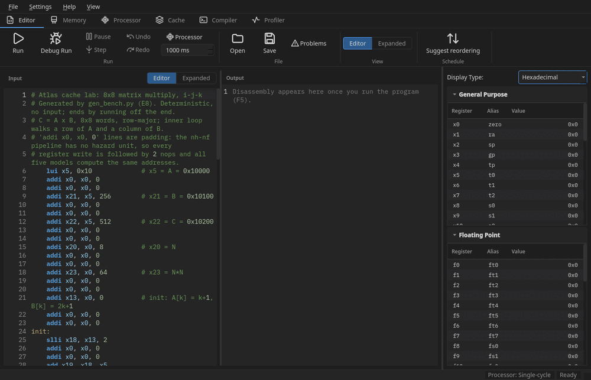
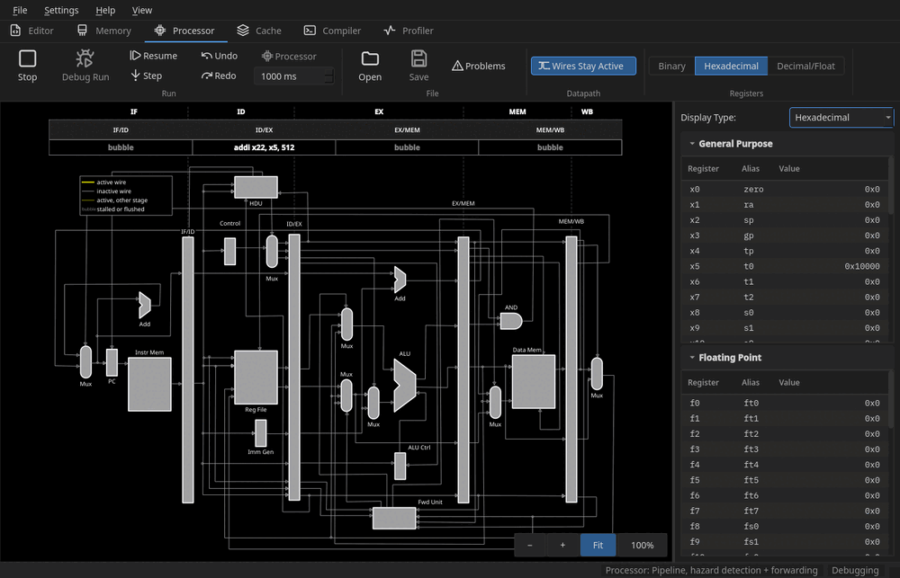
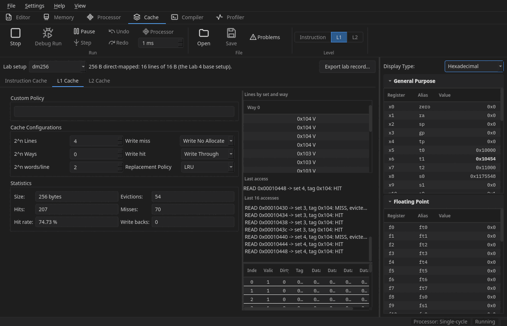
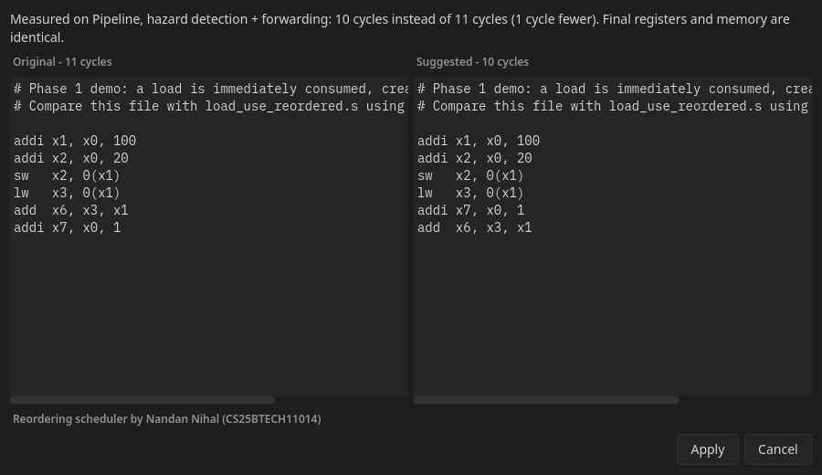

# Atlas

Atlas is a RISC-V assembly simulator for learning programming and
microarchitecture. You write RV64 assembly (I, M, F and D extensions), and run
it on a single-cycle processor or on one of four five-stage pipelines. Then you
watch what the hardware does:
- the hazards and the forwarding paths in a live processor diagram;
- each instruction's progress cycle by cycle;
- the caches filling;
- where the time went.



## What it does

- **Five processor models.** Single-cycle, and a five-stage pipeline in four variants: with or without hazard detection, and with or without forwarding. Choose with the ribbon's **Processor** button, or `--vm` on the CLI.
- **Hazards and forwarding, shown.** The Processor tab draws the datapath and lights the wires each cycle uses, including the hazard unit and the forwarding unit. The pipeline timing grid shows each instruction's stages per cycle, marks stalls and flushes, and explains a selected cell. Undo, Redo and a jump to any cycle step back through a run.
- **Zoom.** The processor diagram fits the window by default and zooms from 25 % to 400 % with Ctrl + mouse wheel, a touchpad pinch, Ctrl+plus / Ctrl+minus / Ctrl+0 (Fit), or the buttons at its bottom right; drag to pan when zoomed.
- **Caches and the Cache Lab.** An instruction cache, an L1 data cache and an L2, each configurable (sets, ways, line size, write policies, LRU, FIFO or a Lua script). The Cache Lab adds:
  - a live set × way view of every line during a run;
  - one-click lab presets;
  - an exported JSON lab record per run.
- **Profiler.** The program counter, cycles, instructions, CPI, IPC, stall and flush breakdowns, branch mispredictions, per-line execution counts and instruction-type counts. Under "More metrics":
  - the retired-instruction mix (per type, per mnemonic, loads and stores);
  - branch statistics (taken rate, misprediction rate);
  - speed-up over the single-cycle processor (cycle counts only);
  - forwarding events;
  - the hottest loops.

  The Cache tab splits misses into compulsory, capacity and conflict. Each number is labelled Measured or Modelled; see [docs/profiler_metrics.md](docs/profiler_metrics.md).
- **Suggest reordering.** Proposes a faster order for independent instructions, offered only when a measured run on the selected five-stage processor gives the same result in fewer cycles.
- **Also:**
  - an editor with completion, diagnostics, find and replace, and breakpoints;
  - memory and register views;
  - a command-line simulator;
  - ten themes.

| Five-stage pipeline (Fit; zoom buttons at the bottom right) | Cache Lab live view during `stride_1` |
| --- | --- |
|  |  |

## Download and run

The release workflow (`.github/workflows/release.yml`) builds three packages, each with the application, `atlas-cli` and `examples/`:

| Package | Run |
| --- | --- |
| `Atlas-<version>-x86_64.AppImage` | `chmod +x Atlas-*.AppImage && ./Atlas-*.AppImage` (without FUSE, add `--appimage-extract-and-run`) |
| `Atlas-<version>-linux-x86_64.tar.gz` (for machines without FUSE) | `tar xzf Atlas-*-linux-x86_64.tar.gz`, then `./Atlas-*/atlas` (the command line: `./Atlas-*/atlas-cli`) |
| `Atlas-<version>-windows-x64.zip` | Unzip, then run `bin\Atlas.exe` |

The packages appear on a GitHub Release for each version tag, and as artifacts of every workflow run.

**What has been tested:**
- **Linux:** the workflow builds on Ubuntu 22.04, so the package needs glibc 2.35 or newer. The workflow had not run yet when this was written. A package built locally on Fedora 44 crashes on start: linuxdeploy's patchelf breaks Fedora's packed-relocation libraries (`scripts/package_linux.sh` explains). So no Linux package has been run successfully yet.
- **Windows:** built and checked only by the workflow. It runs `atlas-cli` on an example and starts the window offscreen for 5 s. Nobody has run it by hand.
- `scripts/check_package.sh` and `scripts/check_package.ps1` are the checks the workflow runs; run them on a downloaded package to repeat them.

To build the packages yourself: `scripts/package_linux.sh` (Linux) or `scripts/package_windows.ps1` (Windows, Qt 6 with MinGW on PATH). They write into `dist/`.

## Requirements

- CMake 3.19 or newer, Ninja, and a C++20 compiler;
- Qt 6.9.2 or newer: Core, Widgets, Network and Concurrent;
- for the tests: network access on the first configure, which fetches GoogleTest 1.14.0;
- for the verification sweeps: Python 3.

**Tested on:** Fedora 44 (x86_64) with GCC 16.2.1, Qt 6.11.2, CMake 4.3.0 and Ninja 1.13.2. No other platform was tested for this release. `CMakePresets.json` also carries Windows presets from the upstream project; they were not tested.

## Build

```bash
./scripts/build.sh                  # = cmake -S . -B build -G Ninja && cmake --build build
```

This produces `build/Atlas` (the application) and `build/atlas-cli` (the command line).

With the Linux CMake presets, which use the system Qt and no hard-coded paths:

```bash
cmake --preset linux-release && cmake --build --preset linux-release   # build-linux/linux-release/
```

The presets are `linux-debug`, `linux-release` and `linux-test`.

## Run

```bash
./build/Atlas
```

Write or open a `.s` file in the Editor tab and press **Run** (or **Debug Run**, **Step**, **Undo**). **Processor** in the ribbon chooses the model. `examples/` has programs to start from.

## Test

```bash
./scripts/test.sh                   # builds build-tests and runs every test: prints total / passed / failed
# or
cmake --preset linux-test && cmake --build --preset linux-test && ctest --preset linux-test
```

There are 4,363 tests, all passing; a serial run takes about 10 minutes. **Run them serially, never `ctest -j`**: the GUI tests share a scratch file. See [docs/TESTING.md](docs/TESTING.md).

## Command line

```bash
./build/atlas-cli examples/scheduler/load_use_original.s --vm rv5-h-f   # batch run: "Cycles -> 11"
./build/atlas-cli --repl                                                # interactive: load, run, step, undo, info ...
```

- `--vm` takes `rvss`, `rv5-nh-nf`, `rv5-h-nf`, `rv5-nh-f` or `rv5-h-f`.
- Registers, disassembly and errors are written under `vm_state/`.
- See [docs/CLI.md](docs/CLI.md).

## Cache Lab

The Cache tab's **Lab setup** box sets L1 to one of 11 lab setups (for example `dm256`, `2w256-lru`, `4w512-wb`) and the step delay to 1 ms. Run one of `examples/cache_lab/` and watch the lines change. **Export lab record...** saves the run as `atlas.lab-record/1` JSON.

The lab's expected hit, miss and eviction counts are measured and pinned by the tests. See [docs/cache_lab.md](docs/cache_lab.md).

## Suggest reordering

**Editor ribbon > Schedule > Suggest reordering** (also in the File menu) shows the original and the suggested order side by side, with both cycle counts. It offers nothing unless the final registers and memory are identical. See [docs/scheduler.md](docs/scheduler.md).



## Project layout

| Path | What is there |
| --- | --- |
| `src/` | The simulator and the application: assembler, processor models, caches, scheduler, UI. |
| `cli/` | The command-line simulator, `atlas-cli`. |
| `main.cpp` | The application's entry point. |
| `test/` | The GoogleTest suite (4,363 tests). |
| `examples/` | Example programs: hazards, F/D, cache lab, scheduler demos, Lua replacement policies. |
| `resources/` | Compiled-in resources: themes, icons, fonts, processor diagrams, instruction data. |
| `external/` | Vendored Lua 5.5.0, for custom cache replacement policies. |
| `verification/` | Independent oracles and sweeps that check the simulator from outside the test suite. |
| `docs/` | Documentation; the index is [docs/README.md](docs/README.md). |
| `scripts/` | Build, test, verification and submission scripts. |
| `.github/` | The release workflow (runs on version tags only). |

## Documentation

[docs/README.md](docs/README.md) indexes every document, with who it is for. For developers:
- [CONTRIBUTING.md](CONTRIBUTING.md);
- [docs/ARCHITECTURE.md](docs/ARCHITECTURE.md);
- [docs/EXTENDING.md](docs/EXTENDING.md), recipes for common changes;
- [docs/FUTURE_WORK.md](docs/FUTURE_WORK.md), the open issues by area.

## Verification

`verification/` holds checkers whose expected values come from models written apart from the product: the RISC-V spec, IEEE 754, a five-stage cycle model, and a textbook cache. Probes linked to the simulator core run each program on all five models. The checkers are:
- an ISA sweep;
- a hazard and cycle sweep;
- an `li` audit;
- an L1 cache sweep;
- an assembler corpus;
- a check that the committed test tables are reproducible;
- negative controls that prove each checker can fail.

```bash
scripts/run_verification.sh         # about 17 minutes
```

See [verification/README.md](verification/README.md), and [verification/RESULTS.md](verification/RESULTS.md) for the last full run.

## Credits and licence

- Atlas began as a fork of an earlier open-source RISC-V simulator (MIT licence). [NOTICE.md](NOTICE.md) names it, credits it, and points to the document describing the changes since the fork.
- MIT licence; see [LICENSE.md](LICENSE.md).
- Reordering scheduler by Nandan Nihal (CS25BTECH11014).
- The six ported themes carry their own licences, listed in [docs/THEMES.md](docs/THEMES.md).
- IBM Plex Mono is under the SIL Open Font Licence (`resources/fonts/IBMPlexMono-LICENSE.txt`).
