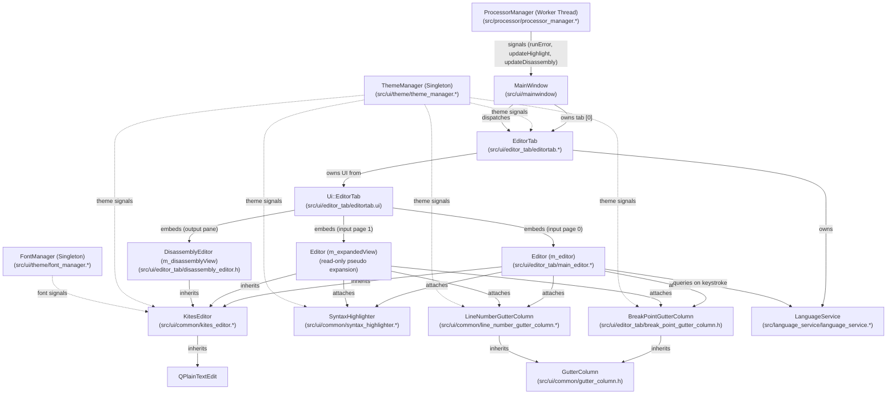

> Historical record. Paths in this document are as of 2026-11-02; see [docs/ARCHITECTURE.md](../ARCHITECTURE.md) for the current layout and [docs/audit/path_mapping.md](../audit/path_mapping.md) for old to new paths.

# Editor UI Architecture & Diagnostics Exploration

## Executive Summary

This exploration documents the architecture of the Atlas assembly editor subsystem (`src/ui/editor_tab/` and related components), traces the current diagnostic pipeline end-to-end, catalogs all styling, theme, and color touchpoints, identifies UI weaknesses, and outlines a staged, risk-ordered implementation roadmap for a cosmetic restyle, an enriched diagnostic model, and a dedicated Problems dock.

No simulator core logic or application source files have been modified.

---

## 1. Subsystem Architecture & Component Map

The editor subsystem is centered on `EditorTab`, which aggregates the primary assembly editor, the pseudo-instruction expanded view, and the disassembly viewer inside a horizontal split layout.



### Detailed Component Inventory

| Component | File Path | Base Class | Primary Responsibilities | Connected Components |
|---|---|---|---|---|
| **`MainWindow`** | `src/ui/mainwindow/mainwindow.h`, `.cpp` | `QMainWindow` | Hosts all application tabs via `QStackedWidget`. Connects simulation runtime signals from `ProcessorManager` to `EditorTab` (disassembly update, pipeline stage line highlights, runtime faults). Handles Open/Save file I/O and initiates program assembly via `tryParseAndLoadProgram()`. | `EditorTab`, `ProcessorManager`, `RegisterContainer`, `ThemeManager` |
| **`EditorTab`** | `src/ui/editor_tab/editortab.h`, `.cpp` | `KitesTab` (`QWidget`) | Controls top-level editor view state (raw editor vs expanded pseudo-instruction view), dispatches disassembly text to `DisassemblyEditor`, manages squiggly underlines via `QTextCharFormat` and `applyDiagnostics()`, loads batch errors from `globals::errors_dump_file_path`, and runs the 300ms debounce timer for `LanguageService`. | `Ui::EditorTab`, `Editor` (`m_editor`, `m_expandedView`), `DisassemblyEditor`, `LanguageService`, `ThemeManager` |
| **`editortab.ui`** | `src/ui/editor_tab/editortab.ui` | Qt Designer XML | Layout containing a horizontal `QSplitter`. Left side has `QLabel("Input")`, radio buttons `editorViewButton` and `expandedViewButton`, and a `QStackedWidget` containing `assemblyTextEdit` and `expandedTextEdit`. Right side has `QLabel("Output")` and `disassemblyTextEdit`. | Compiled to `ui_editortab.h`, referenced by `EditorTab`. |
| **`Editor`** | `src/ui/editor_tab/main_editor.h`, `.cpp` | `KitesEditor` | Assembly code editor. Instantiates `SyntaxHighlighter`, `BreakPointGutterColumn`, `LineNumberGutterColumn`, and `QCompleter`. Maintains breakpoints vector (`m_breakPoints`) and error message tooltip map (`m_errorMessages`). Overrides `paintEvent()` to draw pipeline stage execution highlights (gradient + stage text). Overrides `event()` for `QEvent::ToolTip` mouse hovering. | `BreakPointGutterColumn`, `LineNumberGutterColumn`, `SyntaxHighlighter`, `QCompleter`, `LanguageService`, `ThemeManager`, `FontManager` |
| **`DisassemblyEditor`** | `src/ui/editor_tab/disassembly_editor.h` | `KitesEditor` | Read-only viewer for disassembled binary machine code. Re-implements `paintEvent()` to draw pipeline stage execution highlights. Currently does **not** install gutters (no line numbers, no breakpoints) and does not attach syntax highlighting. | `KitesEditor`, `ThemeManager` |
| **`KitesEditor`** | `src/ui/common/kites_editor.h`, `.cpp` | `QPlainTextEdit` | Base class for all text editors (`Editor`, `DisassemblyEditor`, `CompilerEditor`, `ProfilerEditor`). Manages left and right `GutterColumn` lists, viewport margins, scrolling synchronization, current line background highlighting, font updates from `FontManager`, and editor-specific stylesheet theme styling. | `GutterColumn`, `ThemeManager`, `FontManager` |
| **`GutterColumn`** | `src/ui/common/gutter_column.h` | `QWidget` | Abstract base widget embedded in `KitesEditor` margins. Provides geometry helper functions: `firstVisibleBlock()`, `blockTop()`, `blockHeight()`. | `KitesEditor` |
| **`LineNumberGutterColumn`** | `src/ui/common/line_number_gutter_column.h`, `.cpp` | `GutterColumn` | Computes dynamic width based on `m_editor->blockCount()`. Renders 1-based line numbers. Highlights current cursor line number with full editor foreground color; other lines with muted foreground color. | `KitesEditor`, `ThemeManager` |
| **`BreakPointGutterColumn`** | `src/ui/editor_tab/break_point_gutter_column.h` | `GutterColumn` | Fixed 15px width column. Left-click toggles breakpoints in `Editor::m_breakPoints`; right-click opens a context menu ("Toggle Breakpoint", "Remove All Breakpoints"). Paints red circular markers on breakpoint lines. | `Editor`, `ThemeManager` |
| **`SyntaxHighlighter`** | `src/ui/common/syntax_highlighter.h`, `.cpp` | `QSyntaxHighlighter` | Tokenizes document lines using regexes. Instruction keywords loaded dynamically from `:/instructions/instructions.json` categorized into R32, R64, M, F, D, and PseudoInstruction. Also highlights registers (`x0-x31`, `f0-f31`, ABI aliases), comments (`#...`), labels (`label:`), and numbers (hex, bin, dec). Colors fetched from `ThemeManager::getSyntaxFormat()`. | `ThemeManager` |
| **`LanguageService`** | `src/language_service/language_service.h`, `.cpp` | `QObject` | In-process language helper. Provides static synchronous keyword and label completion (`completions()`) for `QCompleter`. Provides asynchronous diagnostic computation (`requestDiagnostics()`) via `QtConcurrent::run(computeDiagnostics)` and `QFutureWatcher`. | `Diagnostic`, `CompletionProvider`, `customPseudoManager` |

---

## 2. Diagnostics Pipeline: End-to-End Trace

The codebase currently has two diagnostic paths: **Live Diagnostics** (asynchronous background typing loop) and **Build/Run Diagnostics** (batch execution assembly loop).

### Path A: Live Diagnostics (Typing Loop)

1. **Trigger**: User types in `m_editor`. `QPlainTextEdit::textChanged` fires in `EditorTab` (`editortab.cpp:64`).
2. **Debounce**: `m_diagnosticsDebounceTimer` restarts with a 300ms single-shot interval.
3. **Dispatch**: On timeout, `EditorTab::requestLiveDiagnostics()` checks `!m_editor->isReadOnly()` and calls `m_languageService->requestDiagnostics(QString::fromStdString(getRawText()))`.
4. **Execution**: `LanguageService::requestDiagnostics()` invokes `QtConcurrent::run(computeDiagnostics, source)` monitored by `QFutureWatcher<QVector<Diagnostic>>`.
5. **The Missing Link**: Inside `computeDiagnostics(QString source)` (`language_service.cpp:14-43`):
   ```cpp
   std::vector<int> expandedLineToOriginalLine;
   const std::string expanded = customPseudoManager::expandPseudoInstruction(
       source.toStdString(), expandedLineToOriginalLine);

   std::istringstream stream(expanded);
   std::vector<ParseError> parseErrors; // <--- DECLARED EMPTY AND NEVER POPULATED!
   ;

   QVector<Diagnostic> diagnostics;
   // loop over empty parseErrors produces empty diagnostics
   return diagnostics;
   ```
   Because `parseErrors` is never populated, `computeDiagnostics` always returns an empty vector (unless an unhandled exception occurs during pseudo-instruction expansion, which generates a fallback diagnostic at line 1, column 1).
6. **Result Emission**: `handleAssembleFinished()` receives the empty vector and emits `diagnosticsReadySignal(diagnostics)`.
7. **Consumer**: `EditorTab` receives the signal and calls `applyDiagnostics(diagnostics)`.
8. **Squiggle State**: `applyDiagnostics` calls `m_editor->resetErrors()`, sets `extraSelections` to `{}` on `m_editor` and `m_expandedView`. **Live squiggles are currently inactive.**

### Path B: Build / Run Diagnostics (Execution Loop)

1. **Trigger**: User clicks "Run" or "Debug" in the toolbar.
2. **Execution**: `MainWindow::run()` calls `tryParseAndLoadProgram()` (`mainwindow.cpp:422-465`).
3. **Pre-assembly Setup**:
   - `editor->switchToExpandedView()` switches to expanded pseudo-instruction tab.
   - `editor->resetErrorLines()` clears old errors.
   - `editor->setCanWrite(false)` locks the editor.
   - Source text is expanded via `customPseudoManager::expandPseudoInstruction()`.
   - Expanded text is written to disk at `globals::temporary_assembly_file_path`.
4. **Assembler Execution**:
   - `assemble(globals::temporary_assembly_file_path.string())` is called (`src/assembler/assembler.cpp:70-102`).
   - The Lexer generates tokens; `Parser parser(...)` runs `parser.parse()`.
   - On syntax/semantic error, `parser.recordError(ParseError(...))` records the error.
   - When `parser.getErrorCount() > 0`:
     ```cpp
     DumpErrors(globals::errors_dump_file_path, parser.getErrors());
     throw std::runtime_error("Failed to parse file: " + filename);
     ```
   - `DumpErrors()` (`src/utils/utils.cpp:153-181`) writes JSON to `globals::errors_dump_file_path`:
     ```json
     {
         "errorCode": 1,
         "errors": [
             {
                 "line": 4,
                 "message": "Immediate value out of range"
             }
         ]
     }
     ```
5. **Catch & Error Ingestion**:
   - `MainWindow::tryParseAndLoadProgram()` catches `std::runtime_error`.
   - Calls `editor->setErrorLinesFromFile(globals::errors_dump_file_path)`.
   - Displays modal dialog `QMessageBox::critical(this, "Error", e.what())`.
6. **Rendering Squiggles**:
   - `EditorTab::setErrorLinesFromFile()` parses the JSON file and constructs `Diagnostic{line, 0, message}`.
   - Calls `EditorTab::applyDiagnostics(diagnostics)` (`editortab.cpp:211-241`):
     - Clears existing error tooltip messages (`m_editor->resetErrors()`).
     - For each diagnostic:
       - Calls `m_editor->setErrorMessage(diagnostic.line - 1, diagnostic.message)` (stored in `m_errorMessages` map for tooltip display).
       - Constructs `QTextEdit::ExtraSelection` with format `m_squiggleFormat` (`QTextCharFormat::WaveUnderline` with color from `ThemeManager::getEditorErrorColor()`).
       - Moves cursor from `StartOfLine` to `EndOfLine, QTextCursor::KeepAnchor`.
       - Appends to `extraSelections`.
     - Calls `m_editor->setExtraSelections(extraSelections)`.

> [!WARNING]
> **Active Bug in Selection Handling**:
> In `KitesEditor::highlightCurrentLine()` (`src/ui/common/kites_editor.cpp:59-77`), connected to `cursorPositionChanged`, `setExtraSelections()` is called with **only** the current cursor line highlight. Consequently, as soon as the user clicks anywhere or moves the cursor in the editor, **all diagnostic squiggles are instantly blown away**.

### Diagnostics Struct Breakdown

#### Current Struct Definitions

```cpp
// src/assembler/parser.h
struct ParseError
{
    unsigned int line;   ///< The line number where the error occurred.
    unsigned int column; ///< The column number where the error occurred. (UNINITIALIZED!)
    std::string message; ///< The error message.

    ParseError(unsigned int line, std::string message) : line(line), message(std::move(message))
    {
    }
};

// src/language_service/diagnostic.h
struct Diagnostic
{
    int line;   // 1-based, matches editor line numbers
    int column; // 1-based
    QString message;
};
```

#### What is Needed to Carry Severity, Category, and Column Range

To support a modern diagnostic system and Problems dock:

1. **`ParseError` (`src/assembler/parser.h`)**:
   - Add `enum class DiagnosticSeverity { Error, Warning, Information, Hint };`.
   - Add fields:
     - `unsigned int line = 0;` (1-based)
     - `unsigned int start_column = 1;` (1-based)
     - `unsigned int end_column = 1;` (1-based)
     - `DiagnosticSeverity severity = DiagnosticSeverity::Error;`
     - `std::string category = "Syntax";` (or enum `ErrorType`)
   - Update constructors to initialize all fields properly.
2. **Parser Error Recording (`src/assembler/parser.cpp` & `parse_formats/*.cpp`)**:
   - When calling `recordError()`, pass `currentToken().column_number` as `start_column` and `currentToken().column_number + currentToken().value.length()` as `end_column`.
3. **JSON Serialization (`src/utils/utils.cpp` - `DumpErrors`)**:
   - Serialize `"column"`, `"endColumn"`, `"severity"`, and `"category"`.
4. **`Diagnostic` (`src/language_service/diagnostic.h`)**:
   - Align fields:
     ```cpp
     enum class DiagnosticSeverity { Error, Warning, Information, Hint };
     struct Diagnostic {
         int line;           // 1-based
         int startColumn;    // 1-based
         int endColumn;      // 1-based
         DiagnosticSeverity severity;
         QString category;   // "Syntax", "Assembler", "Runtime", "Warning"
         QString message;
     };
     ```
5. **UI Rendering (`EditorTab::applyDiagnostics`)**:
   - Use `startColumn` and `endColumn` to target the specific token rather than selecting `StartOfLine` to `EndOfLine`.
   - Support distinct squiggle formats (e.g., yellow wavy line for warnings, red for errors).

---

## 3. Styling, Themes, Colors, and Fonts Catalog

The following is an exhaustive directory of all styling, fonts, stylesheets, and hardcoded colors across the editor subsystem:

### A. Theme System & Global Stylesheet

| File Path | Roles / Tokens Defined |
|---|---|
| `resources/themes/template.qss` | Global stylesheet template loaded and parsed by `ThemeManager`. Contains base rules for `QWidget`, `QListWidget`, `QTabBar`, `QPushButton`, `QToolButton`, `QLineEdit`, `QTextEdit, QPlainTextEdit` (lines 98-103), `QScrollBar` (lines 158-176), `QSplitter::handle` (lines 179-181), and `QStatusBar`. |
| `resources/themes/tokyo_night.json`<br>`resources/themes/tokyo_night_storm.json`<br>`resources/themes/kites_dark.json`<br>`resources/themes/kites_light.json` | Theme definition JSON files. Provide color values for tokens: `background`, `surface`, `border`, `foreground`, `mutedForeground`, `accent`, `selection`, `currentLine`, `iconColor`, `cacheHit`, `cacheMiss`, and syntax styles (`r32Instruction`, `r64Instruction`, `mInstruction`, `fInstruction`, `dInstruction`, `pseudoInstruction`, `register`, `comment`, `label`, `numberLiteral`). |
| `src/ui/theme/theme_manager.h`, `.cpp` | Manages active and installed themes, parses QSS template placeholders. Provides fallback colors: `getEditorBackgroundColor()` (`#16161e`), `getEditorForegroundColor()` (`#c0caf5`), `getEditorMutedForegroundColor()` (`#565f89`), `getEditorErrorColor()` (`#f7768e`), `getCurrentLineColor()` (`#2a2a2a`), and default syntax formats (`#569cd6`, `#4fc1ff`, `#c586c0`, `#dcdcaa`, `#ff8c00`, `#9cdcfe`, `#6a9955`, `#d7ba7d`, `#b5cea8`). |
| `src/ui/theme/font_manager.h`, `.cpp` | Resolves editor typography. Bundles IBM Plex Mono (`IBMPlexMono-Regular.ttf`, `Bold`, `Italic`, `BoldItalic`) and `Monaco.ttf`. Configures default font size (11pt) and fixed-pitch font matching. |
| `src/ui/theme/app_style.h` | Custom `QProxyStyle` enforcing 1px splitter width (`PM_SplitterWidth`). |

### B. Editor-Specific Styling & Hardcoded Color Values

| File Path | Line(s) | Description / Hardcoded Values |
|---|---|---|
| `src/ui/common/kites_editor.cpp` | 23 | Tab stop distance: `4 * fontMetrics().horizontalAdvance(' ')`. |
| `src/ui/common/kites_editor.cpp` | 67 | Current line highlight: `ThemeManager::getInstance().getCurrentLineColor()`. |
| `src/ui/common/kites_editor.cpp` | 112-114 | Per-widget stylesheet: `QPlainTextEdit { background-color: %1; color: %2; }` from theme manager. |
| `src/ui/common/line_number_gutter_column.cpp` | 28, 42-44 | Background: `themeManager.getEditorBackgroundColor()`. Active line: `themeManager.getEditorForegroundColor()`. Inactive lines: `themeManager.getEditorMutedForegroundColor()`. |
| `src/ui/common/line_number_gutter_column.cpp` | 19, 46 | Gutter width: `12 + fontMetrics().horizontalAdvance('9') * digits`. Right padding: `width() - 6`. |
| `src/ui/editor_tab/break_point_gutter_column.h` | 19, 44 | Gutter fixed width: `QSize(15, 0)`. Breakpoint circle radius: `8`. |
| `src/ui/editor_tab/break_point_gutter_column.h` | 25, 42 | Background: `themeManager.getEditorBackgroundColor()`. **Hardcoded red brush**: `painter.setBrush(Qt::red);` with `Qt::NoPen`. |
| `src/ui/editor_tab/main_editor.cpp` | 108-109 | **Hardcoded pipeline stage highlight gradient**: `gradient.setColorAt(0.0, QColor(255, 255, 255, 0))` to `gradient.setColorAt(1.0, QColor(255, 0, 0, 100))`. |
| `src/ui/editor_tab/main_editor.cpp` | 115 | **Hardcoded pipeline stage text pen**: `painter.setPen(Qt::black);`. Draws stage label ("IF", "ID", "EX", "MEM", "WB") in solid black text regardless of theme. |
| `src/ui/editor_tab/disassembly_editor.h` | 54-55 | **Duplicate hardcoded gradient**: `QColor(255, 255, 255, 0)` to `QColor(255, 0, 0, 100)`. |
| `src/ui/editor_tab/disassembly_editor.h` | 61 | **Duplicate hardcoded text pen**: `painter.setPen(Qt::black);`. |
| `src/ui/editor_tab/editortab.cpp` | 32-33 | Squiggle format: `QTextCharFormat::WaveUnderline` with `ThemeManager::getEditorErrorColor()`. |
| `src/ui/editor_tab/editortab.cpp` | 20-23 | Margins and spacings set to 0 on stacked widget and pages. |
| `src/ui/editor_tab/editortab.ui` | 25-51 | Header section layout with unstyled `QLabel("Input")`, `QRadioButton("Editor")`, `QRadioButton("Expanded")`, and `QLabel("Output")`. |
| `src/ui/common/syntax_highlighter.cpp` | 36-42 | Regex rules for comments (`#[^\n]*`), labels, and number literals (`0x...`, `0b...`, digits). Tokens styled via `themeManager.getSyntaxFormat()`. |

---

## 4. Editor UI Weaknesses

1. **Selection Clobbering Bug (Squiggles Disappear on Cursor Move)**:
   Calling `setExtraSelections()` in `KitesEditor::highlightCurrentLine()` clears all diagnostic squiggles whenever `cursorPositionChanged` fires. The squiggles only persist until the user clicks or types again.
2. **Poor Contrast on Pipeline Stage Highlights (Solid Black Text on Dark Theme)**:
   In `Editor::paintEvent` and `DisassemblyEditor::paintEvent`, the stage text pen is hardcoded to `Qt::black`. On dark themes (Tokyo Night / Kites Dark), drawing black text over the gradient is nearly unreadable.
3. **Full-Line Squiggles Instead of Token Range Underlining**:
   Errors squiggle the entire line from column 0 to line end, even if the error is a single invalid token (e.g., misspelled mnemonic or out-of-range immediate). This looks crude and does not tell the user where the error is located.
4. **Disassembly Viewer is an Incomplete Second-Class Editor**:
   `DisassemblyEditor` lacks line numbers (`LineNumberGutterColumn` is omitted) and syntax highlighting. Furthermore, its painting code is copy-pasted verbatim from `main_editor.cpp` with a comment noting duplicate code.
5. **Cramped, Hardcoded Breakpoint Gutter**:
   The breakpoint gutter is hardcoded to 15px with an 8px red dot. It lacks a hover indicator (a faint ghost circle indicating where a click will place a breakpoint) and uses `Qt::red` rather than a theme token.
6. **Clunky Header Bar with Raw Radio Buttons**:
   The top of `EditorTab` features raw radio buttons `( ) Editor` and `( ) Expanded` paired with unstyled `QLabel("Input")` and `QLabel("Output")`. A modern segmented pill control or styled button group would look significantly cleaner.
7. **Modal Error Dialog Instead of Non-blocking Problems Dock**:
   When assembly fails during Run, Atlas blocks the user with a modal `QMessageBox::critical`. The user must dismiss the dialog before they can view their code or make fixes. There is no list of errors with double-click line navigation.
8. **Dead Live Diagnostics Stub**:
   `LanguageService::computeDiagnostics()` creates an empty vector of errors, giving the illusion of a live diagnostic system while actually doing nothing during editing.
9. **No Gutter or Scrollbar Error Indicators**:
   Neither the line number gutter nor the scrollbar track shows error glyphs or position indicators, forcing users to scroll through long files to hunt for squiggles.

---

## 5. Proposed Implementation Roadmap

The steps below are organized from lowest to highest risk. Purely cosmetic and UI-contained changes come first; data model extensions come next; assembler and language service wiring come last.

| Step | Scope | Category | Files to Touch | Verification Plan | Risk to Simulator |
|---|---|---|---|---|---|
| **Step 1** | **Fix selection clobbering & theme-aware pipeline stage highlight** | Cosmetic & Safe Now | `src/ui/common/kites_editor.h`<br>`src/ui/common/kites_editor.cpp`<br>`src/ui/editor_tab/main_editor.cpp`<br>`src/ui/editor_tab/disassembly_editor.h` | 1. `cmake --build build`<br>2. `ctest --test-dir build-tests` (159/159)<br>3. Launch GUI; move cursor across lines with errors; verify squiggles remain visible.<br>4. Step through execution in RV5S; verify stage labels ("IF", "ID", "EX") use legible theme foreground color. | **None**: Simulator logic untouched. |
| **Step 2** | **Polish Editor Tab header, splitters, and breakpoint gutter** | Cosmetic & Safe Now | `src/ui/editor_tab/editortab.ui`<br>`src/ui/editor_tab/break_point_gutter_column.h`<br>`src/ui/editor_tab/disassembly_editor.h`<br>`resources/themes/template.qss` | 1. `cmake --build build`<br>2. `ctest --test-dir build-tests` (159/159)<br>3. Inspect new segmented toggle bar for Editor/Expanded view.<br>4. Check breakpoint gutter has hover effect and smooth alignment.<br>5. Check disassembly view now shows line numbers. | **None**: Visual styling only. |
| **Step 3** | **Enrich diagnostic data model (`ParseError` & `Diagnostic`)** | Diagnostic Model | `src/assembler/parser.h`<br>`src/language_service/diagnostic.h`<br>`src/utils/utils.cpp`<br>`src/ui/editor_tab/editortab.cpp` | 1. `cmake --build build`<br>2. `ctest --test-dir build-tests` (159/159)<br>3. Verify all existing parser tests pass without regressions.<br>4. Confirm `DumpErrors` writes `column`, `endColumn`, `severity`, and `category` to JSON. | **None**: Non-breaking struct and serialization enhancements. |
| **Step 4** | **Token-level column range reporting in Assembler** | Diagnostic Model | `src/assembler/parser.cpp`<br>`src/assembler/parse_formats/*.cpp` | 1. `cmake --build build`<br>2. `ctest --test-dir build-tests` (159/159)<br>3. Trigger deliberate syntax error in tests; verify column and token length are populated accurately in `ParseError`. | **Low**: Parser error-reporting paths only; successful assembly semantics untouched. |
| **Step 5** | **Precise token squiggles & severity styling in Editor** | Cosmetic & Safe Now (after Step 3) | `src/ui/editor_tab/editortab.h`<br>`src/ui/editor_tab/editortab.cpp`<br>`src/ui/editor_tab/main_editor.cpp` | 1. `cmake --build build`<br>2. `ctest --test-dir build-tests` (159/159)<br>3. Run invalid assembly in GUI; verify squiggle spans only the specific error token rather than the entire line.<br>4. Verify warnings display distinct yellow/amber styling. | **None**: Editor rendering logic only. |
| **Step 6** | **Build Problems Dock with double-click navigation** | Problems Dock | `src/ui/problems_panel/` (new)<br>`src/ui/mainwindow/mainwindow.h`<br>`src/ui/mainwindow/mainwindow.cpp`<br>`CMakeLists.txt` | 1. `cmake --build build`<br>2. `ctest --test-dir build-tests` (159/159)<br>3. Assemble invalid file; verify Problems panel lists all diagnostics with severity icon, message, line, column, and category.<br>4. Double-click row; verify editor navigates cursor to exact line and column. | **None**: New UI dock widget, no simulator interaction. |
| **Step 7** | **Implement live in-memory diagnostics via `LanguageService`** | Live Diagnostics | `src/language_service/language_service.cpp`<br>`src/assembler/assembler.h`<br>`src/assembler/assembler.cpp` | 1. `cmake --build build`<br>2. `ctest --test-dir build-tests` (159/159)<br>3. Type malformed instruction in editor; observe squiggles appear automatically after 300ms pause without pressing Run.<br>4. Correct the syntax; observe squiggles vanish. | **Low**: Requires thread-safe in-memory assembly invocation on stream; must not modify global file paths. |

---

## 6. Classification of Steps

### Purely Cosmetic & Safe Now
- **Step 1**: Fix selection clobbering & theme-aware pipeline stage highlight.
- **Step 2**: Polish Editor Tab header, splitters, disassembly line numbers, and breakpoint gutter.

These steps can be implemented immediately with zero risk to simulation behavior, parser logic, or test baselines.

### Functional Enhancements (Require Explicit User Approval)
- **Step 3 & Step 4**: Extending `ParseError` and updating assembler error reporting.
- **Step 5**: Token-range squiggle rendering.
- **Step 6**: Problems dock addition.
- **Step 7**: Live background diagnostics.
